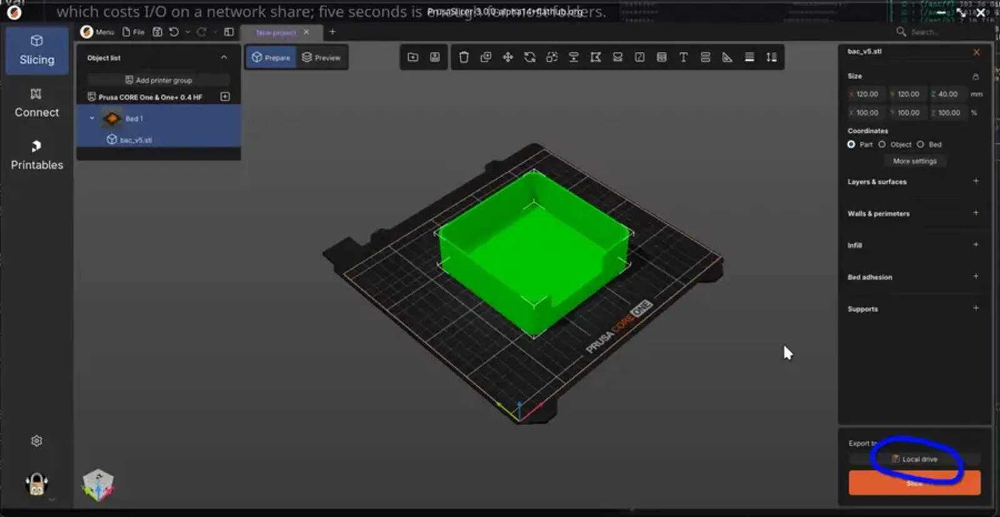
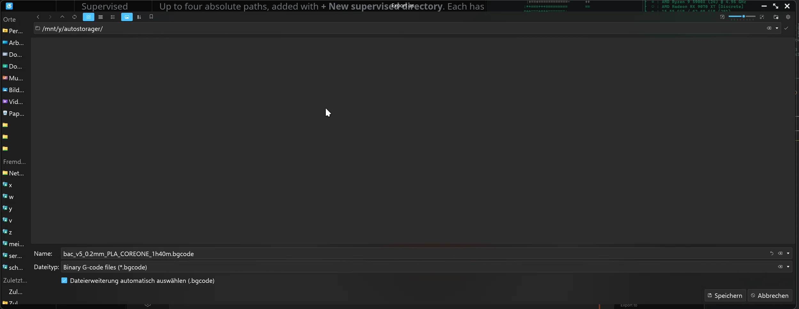
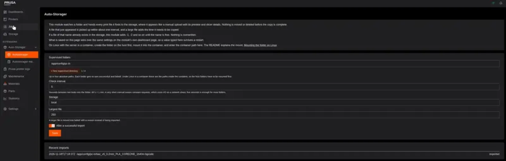
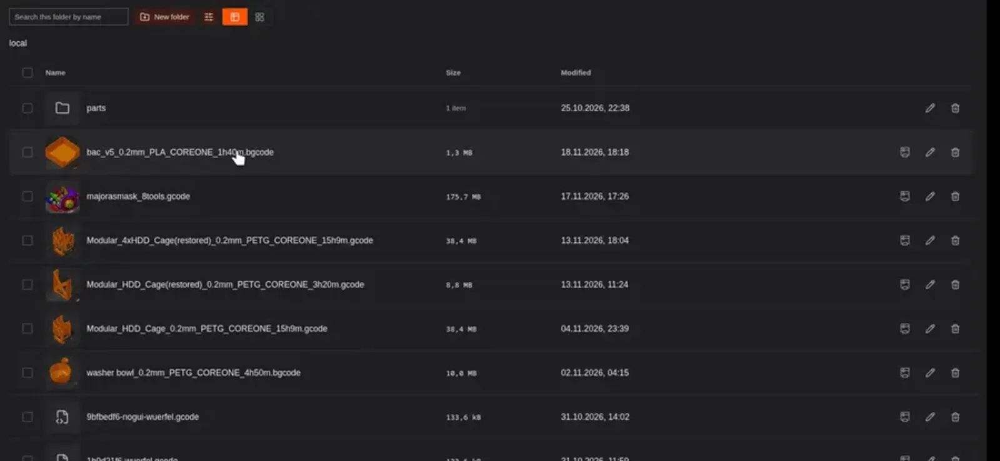
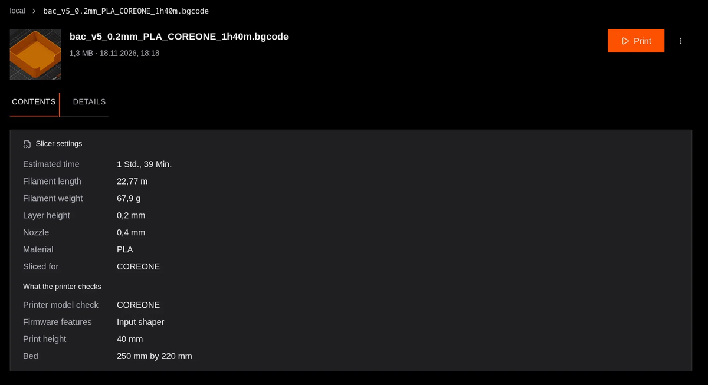

#  Autostorager

A Prusa Connect Local extension that watches up to four folders and hands every
print file it finds to the server's storage. The file arrives there like a
manual upload: with its preview, its slicer details and its print time. Nothing
is moved or deleted before the copy is complete.

## Installation

The extension is a normal module. Install it the way your server takes modules.

### Linux, server in a container

```bash
docker cp autostorager-0.1.0.tar.gz prusa-connect-local:/tmp/
docker exec -w /app prusa-connect-local /app/prusa_connect_local \
  module add github.com/singlergold2/connect-local-autostorager@0.1.0 \
  -from /tmp/autostorager-0.1.0.tar.gz -approve -database sqlite
docker restart prusa-connect-local
```

The `-database sqlite` is required: the settings a person edits on the page live
in a database of the module's own. The module asks for `read_storage` and
`write_storage`, because it looks up free names and writes the files.

### Linux, server as a service

The server runs from a systemd unit and keeps its data beside its configuration.
Run the command as the user that owns that data, then restart the unit.

```bash
sudo systemctl stop prusa-connect
sudo -u prusa-connect /opt/prusa-connect/prusa_connect_local module add \
  github.com/singlergold2/connect-local-autostorager@0.1.0 \
  -from /tmp/autostorager-0.1.0.tar.gz -approve -database sqlite
sudo systemctl start prusa-connect
```

`prusa-connect`, `/opt/prusa-connect` and the user are placeholders: take the
unit name, the folder and the account from your own installation. `module add`
writes beside the configuration the server reads, so the unit's `WorkingDirectory`
is the folder to run it in.

### Linux, server as a process (Linux desktop)

Prusa Connect Local has no desktop application on any system; it is a server you
start. Run the command from the folder that holds `config/`, and restart the
server afterwards.

```bash
cd ~/prusa-connect
./prusa_connect_local module add github.com/singlergold2/connect-local-autostorager@0.1.0 \
  -from ~/Downloads/autostorager-0.1.0.tar.gz -approve -database sqlite
```

### Windows

```powershell
cd C:\prusa-connect
.\prusa_connect_windows_amd64.exe module add github.com/singlergold2/connect-local-autostorager@0.1.0 `
  -from C:\Users\you\Downloads\autostorager-0.1.0.tar.gz -approve -database sqlite
```

Then restart the server. The module lands under
`config\config.d\modules\autostorager\bin`.

### macOS

```bash
cd ~/prusa-connect
./prusa_connect_macos_arm64 module add github.com/singlergold2/connect-local-autostorager@0.1.0 \
  -from ~/Downloads/autostorager-0.1.0.tar.gz -approve -database sqlite
```

Then restart the server. If macOS refuses a downloaded file, clear the
quarantine flag once with `xattr -d com.apple.quarantine <file>`.

## Configuration

Everything is set on the extension's own page: **Autostorager** in the sidebar.

### Linux, server in a container

A container sees only what is mounted into it, so create the folder on the host
first, add it as a volume, and enter the path *inside* the container.

```yaml
# docker-compose.yml, in the server's service
services:
  prusa-connect:
    volumes:
      - /srv/autostorager:/incoming
```

```bash
mkdir -p /srv/autostorager
docker compose up -d
```

The setting is then `/incoming`, not `/srv/autostorager`. The module creates
`successful/` and `failed/` inside it; on the host they appear as
`/srv/autostorager/successful` and `/srv/autostorager/failed`. Up to four mounts
may be added, one per supervised folder.

### Linux, server as a service or a process

The server reads the folder directly; no mount is involved. Enter the absolute
path, such as `/srv/autostorager`, and make sure the account the server runs as
may read and write it:

```bash
sudo mkdir -p /srv/autostorager
sudo chown prusa-connect:prusa-connect /srv/autostorager
```

### If Prusa Connect Local runs on this computer

Then there is no share to set up. Create a folder, enter its path on the module's
page, done. On Linux or macOS:

```bash
mkdir -p ~/Autostorager
```

On Windows:

```powershell
mkdir C:\Autostorager
```

The path is the whole configuration: `~/Autostorager`, `/Users/you/Autostorager`
or `C:\Autostorager`. Save prints there and the module imports them.

### What to enter as the supervised folder

The field takes the path **as the server sees it**, not as your computer sees it.
Those differ exactly when the server runs in a container.

```
Server without a container   /srv/autostorager
Server in a container         /app/config/pc-in, or whatever path inside the
                              container the host folder is mounted at
Your computer                 Y:\ or /mnt/y, never the value to enter here
```

`/app/config/pc-in` looks odd because it is a container path. In this example
the host folder is `pc-in` inside the server's config directory, and that
directory is mounted into the container as `/app/config`. Your server's folders
and mount points are your own; what matters is that the path you enter is the
path the container sees. If it does not exist there, the module says so under
**Recent imports** on the next check, with the error the operating system
returned.

### How to, in pictures

**1. Export from the slicer, into the network drive.**



**2. Save into the shared folder.**



**3. Enter that folder on the module's page.**



**4. The file appears in Storage.**



**5. With its slicer details and preview.**



### The easy way: a folder on the server, mounted on your PC

1. **On the server**, create a folder and share it:

```bash
sudo mkdir -p /srv/autostorager
sudo chown prusa-connect:prusa-connect /srv/autostorager   # or your server's user
```

```ini
# /etc/samba/smb.conf
[autostorager]
   path = /srv/autostorager
   browseable = yes
   read only = no
   valid users = your-user
```

```bash
sudo systemctl restart smbd
sudo smbpasswd -a your-user
```

2. **On your computer**, mount that share once; it then appears as a normal
   drive or folder:

```
Windows   net use Y: \\192.168.178.3\autostorager
Linux     //192.168.178.3/autostorager /mnt/y cifs username=your-user,uid=1000 0 0
macOS     Finder, Gehe zu, smb://192.168.178.3/autostorager
```

3. **In Autostorager**, enter the server path of that folder, `/srv/autostorager`.
   If the server runs in a container, enter the path the container sees, not the
   host path. That is the one thing that catches people out: a container only
   sees what is mounted into it.

4. **Save your prints there.** PrusaSlicer exports to `Y:\` or `/mnt/y`, the file
   lands on the server, and the module imports it from the folder. It appears
   under `successful/` in the same share once it is done.

### Windows

The server is a normal process and reads the folder directly. Enter the full
path, such as `C:\Autostorager`, and save. `successful\` and `failed\` are created
inside it.

### macOS

Same as Windows, with a POSIX path such as `/Users/you/Autostorager`. No mount
is involved when the server runs as a process.

### The settings

| Setting | Meaning |
| --- | --- |
| Supervised folders | Up to four absolute paths, added with **+ New supervised directory**. Each has its own `successful/` and `failed/`. No folder means nothing is watched. |
| Check interval | Seconds between two looks. 60 s = 1 min. A short interval means constant requests, which costs I/O on a network share; five seconds is enough for most folders. |
| Storage | The storage instance files are imported into, `local` on most servers. |
| Largest file | In megabytes, 250 by default. A larger file goes to `failed/` with the reason. |
| Move on success | Move the source into `successful/` after the commit. |

The page stores these in the module's own database. The same values also appear
on the module's dashboard page; what is saved on the page wins and survives a
restart.

## What happens to a file

1. Each supervised folder is read every few seconds. Only `.gcode` and `.bgcode`
   files are taken.
2. A file is read once its size has held still across two checks, so a file a
   slicer is still writing is left alone.
3. The module asks the storage for a free name and appends `-1`, `-2` and so on
   if the name is taken. Nothing is ever overwritten.
4. The bytes are copied into the storage through the same API an upload uses.
   Only after that copy is committed is the source moved into `successful/`.
5. A file that cannot be imported is moved into `failed/`, and a text file
   beside it names the step, the reason, the time and the path.

## Checking it works

Drop a small `.gcode` into a supervised folder. Within about one interval it
should leave the folder, appear under `successful/`, and show up under **Storage**
with its preview. The **Recent imports** list on the page and the dashboard card
tell the same story, including a failure with its reason.

## Development

```bash
sh install.sh              # build the bundle and the binary, install into the demo
TARGET=app sh install.sh   # install into the real app instead
```

The build needs the component library of a Prusa Connect checkout; `install.sh`
builds it if `packages/svelte/dist` is missing.

## Licence

MIT.
